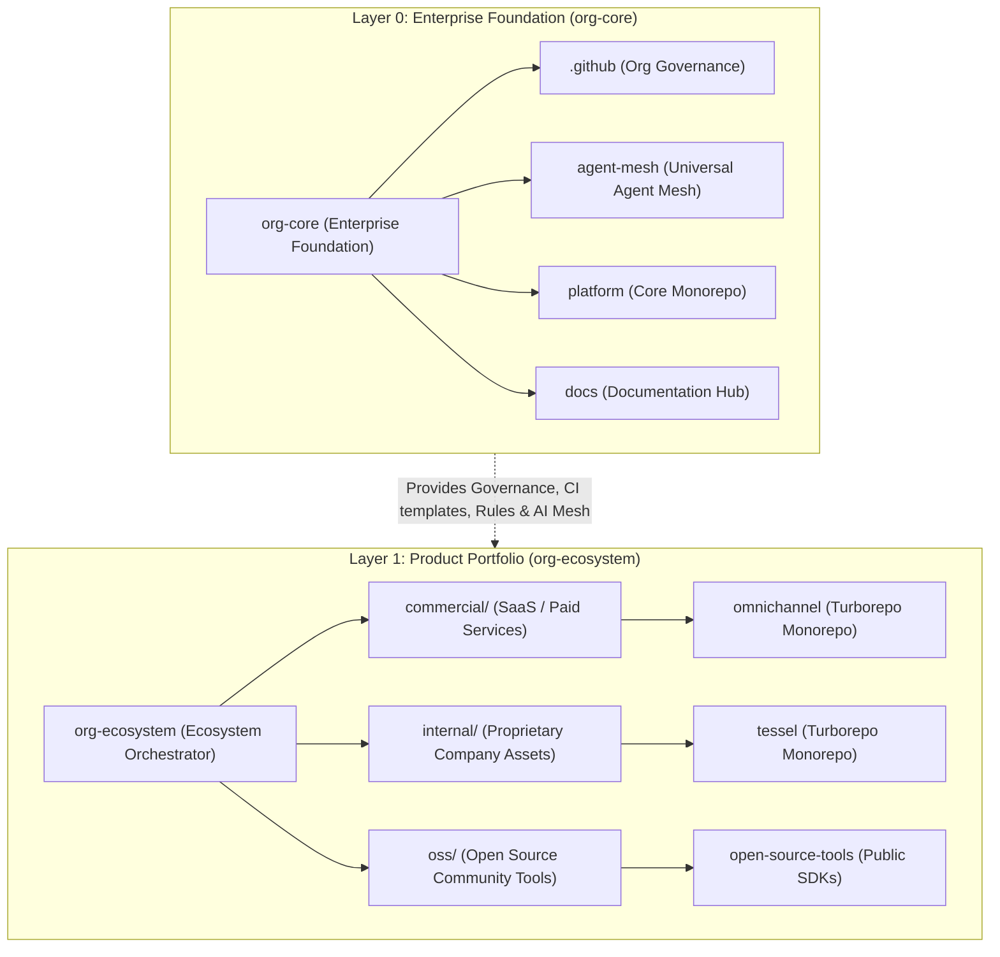

# tupynambalucas-dev Product Portfolio & Ecosystem Meta-Repository

Central orchestrator and unified workspace for customer-facing SaaS products, proprietary internal assets, and open-source solutions across the `tupynambalucas-dev` organization.

This umbrella meta-repository orchestrates autonomous portfolio products via [Mani](https://manicli.com) and multi-root IDE workspaces, providing unified cross-repository developer workflows while preserving completely independent Git histories, branches, release cycles, and CI/CD pipelines.

---

## Dual Meta-Repository Topology

The organization operates under a two-tier meta-repository architecture:



---

## Managed Portfolio Repositories

| Repository | Namespace | Branch | Description |
| :--- | :--- | :--- | :--- |
| [`omnichannel`](./commercial/omnichannel/README.md) | `commercial/` | `main` | Commercial omnichannel messaging gateway and FSM workflow engine for WhatsApp and Instagram. |
| [`tessel`](./internal/tessel/README.md) | `internal/` | `main` | Proprietary enterprise core platform, intelligence engine, and intellectual property. |
| `oss/*` | `oss/` | `main` | Open-source developer tools, public SDKs, and community extensions. |

---

## Multi-Root IDE Workspace

Open [org-ecosystem.code-workspace](./org-ecosystem.code-workspace) in VS Code or Antigravity IDE to mount all portfolio repositories in a unified workspace with integrated Mani tasks:

- `org-ecosystem (Ecosystem Orchestrator)`
- `omnichannel (Commercial SaaS Monorepo)`
- `tessel (Proprietary Enterprise Monorepo)`

---

## Getting Started

### 1. Prerequisites

Install `mani` using Scoop:

```powershell
scoop bucket add poldi https://github.com/aliesbelik/poldi
scoop install mani
```

### 2. Clone Workspace and Synchronize Repositories

Clone the ecosystem orchestrator and synchronize projects:

```bash
git clone git@github.com:tupynambalucas-dev/org-ecosystem.git
cd org-ecosystem

# Synchronize all projects
mani sync

# OR synchronize selectively by category
mani sync --tags commercial   # Sync only commercial SaaS solutions
mani sync --tags internal     # Sync only internal proprietary assets
mani sync --tags oss          # Sync only open-source tools
```

### 3. Daily Multi-Repository Operations

Run batch commands across all projects:

```bash
# Check status across all projects
mani run status

# Fetch remote updates
mani run fetch

# Pull latest main across all projects
mani run pull

# Show active branches
mani run branch
```

---

## Development Workflow and Governance

All development across repositories must comply with organizational governance:

1. **Cryptographic Signatures**: All Git commits and annotated tags MUST be signed using SSH (`git commit -S -m "..."`). Unsigned commits are rejected by repository rulesets.
2. **Conventional Commits**: Commit messages must follow the Conventional Commits v1.0.0 specification (`feat`, `fix`, `docs`, `chore`, etc.).
3. **Zero-Emoji Policy**: Emojis are strictly prohibited in commit messages, documentation, code comments, and chat responses.
4. **Autonomous Single-Branch GitHub Flow**: Each product repository operates independently. Developers create feature branches (`feat/<slug>`, `fix/<slug>`), push them, and open Pull Requests against `main`. No submodule pointer bumps are required.

---

## License

Licensed under the [Apache License 2.0](./LICENSE). Copyright (c) 2026 tupynambalucas.dev.
